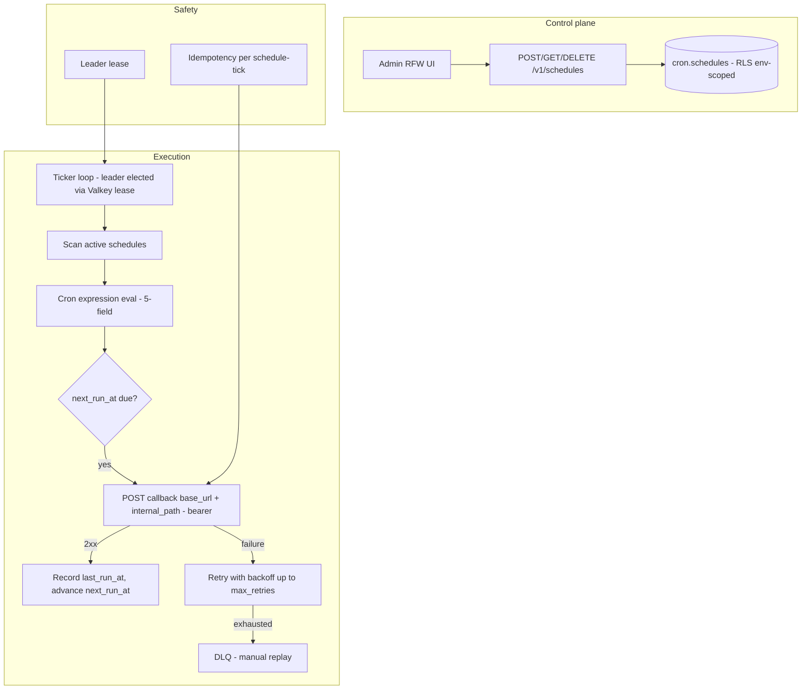

# Design Doc: Sentin8:Cron - Distributed Scheduler

## 1. Summary

Sentin8:Cron is the platform's standalone distributed scheduler. It
stores recurring schedules (5-field cron expressions) with per-schedule
callback configuration, and one distributed ticker loop computes next
runs and fires callbacks to the owning service's internal API. Services
delegate recurring work (statement regeneration, maintenance sweeps,
trace archiving) here instead of running embedded schedulers.

## 2. Motivation

- **One clock for the fleet.** Embedded schedulers drift, double-fire
  across replicas, and are invisible in operations. A single scheduler
  owns all timing, retry policy, and schedule inspection.
- **Callbacks, not coupling.** Cron never imports domain logic; each
  schedule carries its callback target (`base_url`, `internal_path`,
  `auth_token`) and calls back the owner - the owner's data access
  stays with the owner.
- **Idempotent execution.** Missed/duplicate ticks happen (retries,
  leader transitions); schedules carry a retry budget and consumers
  must be idempotent, matching the platform's
  at-least-once + idempotent-consumer posture.
- **No mixed fleets, no shadow clocks.** The ticker is one loop with
  leader election; schedule state changes (pause/delete) take effect
  before the next tick.

## 3. Architecture & High-Level Design

- **Schedule lifecycle** - `active` schedules are picked up by the
  ticker; `paused` schedules are skipped (retained); `deleted`
  schedules are removed.
- **Ticker** - single-loop, Valkey-lease leader election (only the
  leader fires), per-schedule retry budgets, and
  `next_run_at` advancement after each attempt.
- **Cron expressions** - full 5-field support with validation at
  registration time (malformed expressions rejected at the API, not
  at tick time).
- **DLQ** - failed deliveries land with their failure reason; replay
  re-fires the callback.

## 4. Key Traits and Data Structures

- **`Schedule`** - the stored record: id, domain, type, cron
  expression, IANA `timezone` (default `'UTC'`, validated at create
  time), status, last/next run timestamps, org/env (RLS key).
- **`CreateScheduleRequest` / `ScheduleResponse`** - the API wire
  types (mirroring the shared cron-contracts crate with the
  `target_config`/`max_retries` extensions).
- **`target_config`** - the callback envelope:
  `{"base_url", "internal_path", "auth_token"}`; `max_retries` is the
  per-schedule retry budget (default 3).
- **`cron_expr`** - the 5-field parser/evaluator: minute, hour,
  day-of-month, month, day-of-week; supports lists, ranges, steps, and
  the `*` wildcard. With a schedule's IANA `timezone` set, the
  wall-clock fields match local time (`0 9 * * *` = 9am local,
  DST-safe) and the result maps back to a UTC `next_run_at`; without
  one, evaluation is anchored on UTC.

## 5. Rationale, Trade-offs, and Alternatives

- **5-field cron over bespoke DSL.** Universally understood, trivially
  auditable, and directly comparable across verticals. Alternatives -
  interval seconds or cron-plus-sugar - either lose expressiveness or
  add parsing surface. Sub-second scheduling is not a platform need.
- **Leader-elected single ticker.** Valkey-lease leadership means only
  one replica fires per tick; firing from every replica would
  duplicate every callback (consumers would need dedupe on every
  tick). The lease TTL bounds failover time.
- **Callback config stored per schedule.** The owner supplies its
  target at registration; centralizing endpoints in Cron would make
  Cron a config owner and double the update surface. Trade-off: the
  callback token transits registration (it is an M2M-issued
  credential).
- **UTC storage, local-wall evaluation.** `next_run_at` is always a
  UTC instant, but a schedule may declare an IANA `timezone` (default
  `'UTC'`): the expression's wall-clock fields then match local time
  and DST folds resolve to the earliest UTC instant (chrono-tz).
  Mixing local/UTC silently would double-book hours; the explicit
  column makes the semantics per-schedule.
- **Per-schedule retry budget.** Different domains tolerate missed
  ticks differently (a report can lag; a payment sweep must not
  double-fire). A per-schedule budget plus idempotent consumers beats
  a global constant.
- **Registration-time validation.** Malformed expressions are rejected
  at create time - a schedule that silently never fires is worse than
  a 400.
- **DLQ with replay.** Exhausted retries park the tick with its
  failure reason; replay re-fires on demand (the consumer's
  idempotency still applies). Silent drops are a defect.
- **Rejected: in-process schedulers.** Every service would re-implement
  leader election, retry, DLQ, and observability; the shared scheduler
  centralizes all of it behind one API.
- **Rejected: DB-only queue with polling.** Ticker polling against
  Postgres adds connection pressure and jitter; Valkey lease + PG
  storage splits state (schedules) from coordination (leases)
  appropriately.

## 6. Internal Implementation & Invariants (Private Design)

- **Invariants:**
  - Cron does NOT create its database or tables - the init/seed SQL is
    applied by `vertical init`; the service starts on an existing
    schema.
  - Every schedule write runs with the tenant context set on the same
    connection inside the same explicit transaction (transaction-local
    RLS).
  - Callbacks fire only from the leader; non-leaders skip the tick
    (renewing the lease).
  - `next_run_at` advances even on failure (a persistently failing
    schedule does not hot-loop); `max_retries` bounds per-tick
    retries.
  - Callback auth uses the schedule's registered token; non-2xx
    responses count as failure and retry.
  - Schedule deletes are soft (status) so the audit trail and DLQ
    references stay resolvable.
- **Boot (shell-owned).** The shell owns the listener stack; Cron
  builds its capped pool, enforces PG18, loads the Shield engine from
  shell boot (single engine), and spawns the ticker after the pool is
  up.
- **Observability.** Ticker metrics (fired/failed/retried counts,
  schedule lag) publish to the shared metrics channel; DLQ depth is
  visible in the admin UI.

## 7. Unresolved Questions / Future Designs

- Schedule versioning is an update-in-place with an audit event (effective on
  the next tick) - version tables add bookkeeping without a consumer need; a
  non-goal.
- Callback result capture retains status + duration per tick (the run row
  carries them) and caps response-body capture to the failure path.

---

**Design attribution:** sentin8:cron and its underlying concepts were designed by Hamid Jahanzad <Hamid@Jahanzad.com>.
